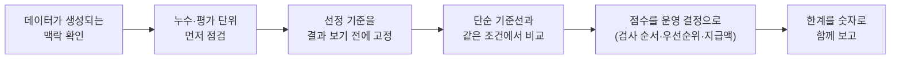

# 안녕하세요, 전건우입니다 👋

### 검증 설계부터 운영 제안까지, 실제 운영에서도 유지되는 숫자를 만드는 데이터 사이언티스트

홍익대학교 컴퓨터공학과 3학년 · **Data Scientist / Data Engineer** 지향 · 2026.12부터 풀타임 근무 가능

> I'm a CS student who builds data pipelines and ML models, and checks whether the numbers still hold in real operation —
> by catching leakage, designing time- and group-aware validation, and turning model scores into operating decisions.

📫 j2tori@gmail.com

---

## 핵심 역량

| 역량 | 증거 |
|---|---|
| **검증 설계 · 데이터 누수 진단** | 행 단위 검증의 성능 과대평가를 사출 그룹 CV로 바로잡음 (PR-AUC 0.18 → 0.12, [KAMP](https://github.com/j2tori-design/kamp-injection-defect-prediction)) · 무작위 평가가 운영 성능을 약 2배 부풀리고 그 원인이 평가 기간임을 실증 ([단독 논문](https://github.com/j2tori-design/shelter-euthanasia-evaluation)) |
| **대용량 데이터 결합 · 재현 가능한 파이프라인** | 카드 매출 약 285만 행 + 유동인구·기상·지하철 데이터를 지역×업종×일 패널로 결합하고, 수집부터 발표 수치까지 15개 스크립트로 재현 ([빅콘테스트](https://github.com/j2tori-design/bigcontest-2026-rain-damage)) |
| **분석 결과를 운영 의사결정으로** | 위험점수 상위 20% 검사로 CN7 불량 12/13건 포착 (KAMP) · 입소 동물 32.4% 검토로 안락사 78.2% 탐지 (논문) · 호우 지수형 손실보전 지급액-실손 상관 0.74 (빅콘테스트) |

---

## 대표 프로젝트

<table>
<tr>
<td width="50%" valign="top">

### [하수 감시 감염병 조기예측](https://github.com/j2tori-design/kowas-wastewater-early-warning)
**2026 DATA·AI 분석 경진대회 (KISTI)** · 개인 · 2026.11

시·도 하수 농도를 **전국 공통 유행파 + 지역 편차**로 분해해 2주 뒤 농도·급증 경보 예측
- 정량점수 0.2212 → **0.3005**, 10개 평가 창 **모두** 기준 모델보다 높음
- 성분별 제거 실험으로 성능의 원천(공통파 −0.062) 확인
- `NumPy` `시계열 분해` `롤링 백테스트`

</td>
<td width="50%" valign="top">

### [같은 비, 다른 피해](https://github.com/j2tori-design/bigcontest-2026-rain-damage)
**제14회 빅콘테스트 AI데이터분석** · 개인 · 2026.10

카드·유동인구·기상·지하철 데이터로 호우 취약 상권을 진단하고 **지수형 손실보전** 설계
- 춘천 3일 순손실 **−14.6%** (강남의 2배, p = 0.022)
- 매출 감소의 **56%** 가 방문객 감소 경로 (매개 분석)
- `statsmodels` `축소추정` `15개 스크립트 파이프라인`

</td>
</tr>
<tr>
<td width="50%" valign="top">

### [사출성형 불량 예측과 검사 우선순위](https://github.com/j2tori-design/kamp-injection-defect-prediction)
**제6회 KAMP 제조AI 경진대회** · 개인 · 2026.09–10

데이터에 없는 **2-캐비티 사출 구조를 복원**하고 그룹 CV로 누수 차단
- 행 단위 평가의 과대평가 **52%** 차단 (PR-AUC 0.184 → 0.121)
- 상위 20% 검사로 CN7 불량 **12/13건** 포착, 위험 등급 불량률 24배 차이
- `Extra Trees` `CatBoost` `SHAP` `그룹 CV`

</td>
<td width="50%" valign="top">

### [안락사 예측의 평가 설계 재검토](https://github.com/j2tori-design/shelter-euthanasia-evaluation)
**한국정보기술학회 추계 학술대회 투고** · 단독 저자 · 2026.09–10

같은 데이터에서 **평가 방식에 따라 보고 성능이 달라지는 원인**을 누수·판정 방식·평가 기간으로 분해
- 무작위 평가가 운영 성능을 **약 2배** 부풀림, 성별 'Unknown' 누수 발견
- 입소 32.4% 검토로 안락사 **78.2%** 탐지, 단순 규칙 대비 우위는 미확인으로 보고
- `XGBoost` `시간 기준 검증` `군집 부트스트랩`

</td>
</tr>
</table>

## 그 밖의 프로젝트

| 프로젝트 | 구분 | 내용 |
|---|---|---|
| [보호소 운영 우선순위 2단계 예측](https://github.com/j2tori-design/animal-shelter-matrix) | 교내 AI 학회 MATRIX 컨퍼런스 · **팀 조장 · 최우수상** (10팀 중) · 2026.07–08 | 다중분류를 입양 여부 + 비입양군 안락사 위험의 2단계로 재정의, 안락사 모델 Recall 0.817 · PR-AUC 0.777 |
| [학회 스터디 프로젝트](https://github.com/j2tori-design/ML-Project) | MATRIX 25-2 컨퍼런스 · 팀 조장 · 2025.11–2026.01 외 | 생활 습관 데이터 행복도 분류 (구간화 4방식 비교, ROC-AUC 0.91) · 학생 우울증 예측 (모델 4종 비교, 임계값 조정) |
| [Algorithm](https://github.com/j2tori-design/Algorithm) | 코딩테스트 준비 | 탐색·DP·그리디·최단경로 등 Python 풀이 |
| [DA-study](https://github.com/j2tori-design/DA-study) | 학습 기록 | pandas 기반 데이터 분석 정리 |

---

## 일하는 방식

- **평가를 먼저 의심합니다.** 같은 모델도 평가 단위(행 vs 그룹), 평가 기간(무작위 vs 미래), 판정 방식(최대 확률 vs 위험 순위)에 따라 성능이 크게 달라지는 것을 매 프로젝트에서 수치로 확인했습니다.
- **생성형 AI는 검증하면서 씁니다.** LLM 코딩 에이전트(Claude Code)에 목표와 제약을 명시해 분석을 진행하고, AI가 낸 수치·해석은 코드 실행과 추가 분석으로 교차검증합니다. 활용 범위는 프로젝트마다 문서로 남깁니다 ([예: 빅콘테스트 LLM 활용 설명자료](https://github.com/j2tori-design/bigcontest-2026-rain-damage/tree/main/presentation)).
- **대회 데이터는 공개하지 않습니다.** 재배포가 금지된 원본·가공 데이터는 저장소에 넣지 않고, 코드와 집계 결과만 공개합니다.

---

## 기술 스택

**Language** &nbsp;

**Data / ML** &nbsp;

**Visualization** &nbsp;

**Tools** &nbsp;

**학습 중** &nbsp; PyTorch · Docker · AWS / GCP 기초

---

## 학력 · 자격 · 활동

| | |
|---|---|
| 🎓 **홍익대학교 컴퓨터공학과** (2024.03 – 재학) | 이수: 자료구조 및 알고리즘, 객체지향 프로그래밍, 컴퓨터구조, 컴퓨터네트워크, 확률 및 통계 · 수강 중: 기계학습, 데이터베이스시스템, 운영체제, 데이터시각화, 통계학 |
| 📜 **자격** | ADsP (데이터분석 준전문가) · SQLD (SQL 개발자) — 한국데이터산업진흥원, 2026.09 |
| 🧠 **MATRIX** 홍익대 인공지능 학회 (2025.09 – 2026.08) | DA/ML 스터디, 컨퍼런스 팀 조장 2회, 26-2 최우수상 |
| 📊 **BDAI** 인공지능 학회 (2026.03 – 현재) | Python·SQL 기본·심화 과정 |

---

📂 프로젝트 저장소를 한 페이지로 모아 본 목차는 [contest-portfolio](https://github.com/j2tori-design/contest-portfolio)에 있습니다.
